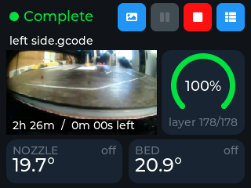
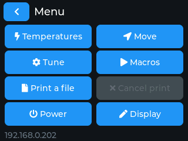
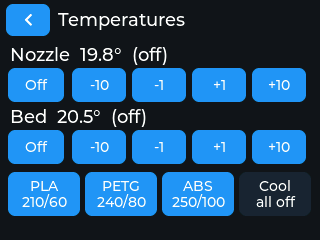
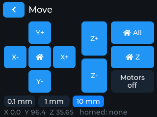
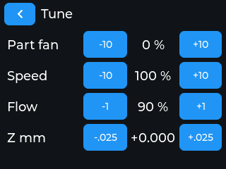
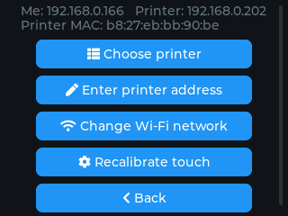
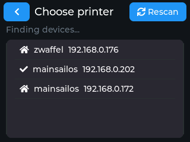

# printdisplay

A touchscreen print monitor and remote control for **Klipper / Moonraker** 3D
printers, running on the cheap **ESP32-2432S028 "Cheap Yellow Display"** (CYD).
You get a small Mainsail on your desk: progress, temperatures, the webcam,
pause and e-stop, plus a menu with jogging, tuning, macros and file printing.
You don't need to install anything on the printer.

<p align="center">
  
</p>

| Menu | Temperatures | Move |
|:---:|:---:|:---:|
|  |  |  |
| **Tune** | **Display settings** | **Choose printer** |
|  |  |  |

*These are real screenshots, grabbed from the device over serial with
`tools/screenshot.py`.*

## Features

- **Dashboard**: the print state, file name, a progress arc with the
  current and total layer, nozzle and bed temperatures with heater power,
  and the elapsed and remaining time (estimated close to the way Mainsail
  does it).
- **Webcam**: the Mainsail webcam is shown live on the dashboard, and
  full screen when you tap it.
- **Pause / resume** with one tap. **E-stop** and **firmware restart** need
  a half-second hold, so a stray touch can't kill a print.
- **Menu**: temperatures and presets, jog/home, fan, speed, flow and Z
  babystepping, macros, starting a G-code file, cancelling a print, and
  power actions (restart Klipper or Moonraker, reboot or shut down the
  host).
- **Finds printers automatically**: it scans the Wi-Fi subnet for Moonraker
  instances, and keeps following the printer by MAC address when DHCP
  gives it a new IP.
- Stays responsive when the printer is offline, because polling runs in its
  own FreeRTOS task.

## Hardware

- **ESP32-2432S028R** ("Cheap Yellow Display"): ESP32, 2.8" 320×240
  ILI9341 panel, XPT2046 resistive touch. The variant without PSRAM is fine.
- A USB cable for flashing and power.
- A Klipper printer running **Moonraker** (Mainsail, Fluidd, KIAUH
  installs and so on), on the same 2.4 GHz Wi-Fi network.

## Flashing

### Option A: prebuilt binary (no toolchain)

1. Download `printdisplay-cyd.bin` from the
   [latest release](../../releases/latest).
2. Flash it at offset **0x0**:
   - **In the browser**: open <https://espressif.github.io/esptool-js/> in
     Chrome or Edge, click *Connect*, choose the CYD's serial port, set
     the flash address to `0x0`, pick the file and click *Program*.
   - **From the command line**:
     ```sh
     pip install esptool
     esptool.py --chip esp32 --port /dev/ttyUSB0 --baud 921600 write_flash 0x0 printdisplay-cyd.bin
     ```
     On Windows the port is something like `COM5`. On macOS it is
     `/dev/cu.usbserial-*`.

If the board isn't detected, hold **BOOT** while you plug it in (or while
you press **RST**), then try again. Some boards need the CH340 USB driver.

### Option B: build from source with PlatformIO

```sh
git clone https://github.com/KasperVerweij/printdisplay.git
cd printdisplay
pio run -t upload        # build and flash
pio device monitor       # optional: serial log at 115200 baud
```

This works the same from VS Code with the PlatformIO extension: open the
folder and click *Upload*.

## First start

1. **Touch calibration**: four crosshairs appear one after another, one in
   each corner. Tap the centre of each. The result is saved. You can redo
   it later from *Display → Recalibrate touch*.
2. **Wi-Fi**: pick your network from the list and type the password.
3. **Choose the printer**: go to ☰ → *Display* → *Choose printer*. The
   display scans the subnet (about 15 s) and lists every Moonraker it finds
   by hostname and IP. Tap yours. To type an address yourself, use *Enter
   printer address*: `ip`, `ip:port`, a hostname or a MAC address all work
   (the default port is 7125).

All settings are stored in flash, so they survive a reboot or power cut.

### Moonraker access

The display talks to Moonraker without logging in. If the dashboard shows
**HTTP 401**, add the display's IP (or your LAN range) to `moonraker.conf`
and restart Moonraker:

```ini
[authorization]
trusted_clients:
    192.168.0.0/24
```

Most Mainsail and Fluidd images already trust the local network.

## Using it

### Dashboard top bar

| Button | Action |
|---|---|
| 🖼 camera | Full-screen webcam (about 1 fps at 240×135) |
| ⏸ pause / resume | One tap. After an e-stop or a Klipper error this button becomes an orange **firmware restart** (hold it). |
| 🟥 E-stop | **Hold about 0.5 s.** The button gets a white outline while you hold it. The stop is sent on its own connection and retried until Moonraker confirms. |
| ☰ menu | Everything else (see below) |

If the printer has a webcam set up in Mainsail, the feed appears top
left. Tap it to go full screen. Without a webcam, the dashboard uses a
larger layout without the camera.

### Menu

- **Temperatures**: change nozzle and bed targets with Off / −10 / −1 /
  +1 / +10, or use the presets PLA 210/60, PETG 240/80, ABS 250/100 and
  Cool.
- **Move**: jog X/Y/Z in steps of 0.1, 1 or 10 mm, home all, XY or Z, and
  turn the motors off. Disabled while printing.
- **Tune**: part fan, speed (M220), flow (M221) and Z offset
  (babystepping in 0.025 mm steps).
- **Macros**: every `gcode_macro` except those starting with `_`. Asks you
  to confirm before running one.
- **Print a file**: the 16 newest G-code files. Asks you to confirm.
- **Cancel print**: asks you to confirm.
- **Power**: restart Klipper, firmware or Moonraker, or reboot or shut
  down the host. Each asks you to confirm.
- **Display**: choose the printer, change Wi-Fi, recalibrate touch.

Taps add up immediately (three taps on +10 give +30). Klipper's messages,
such as *Must home axis first*, appear in the bottom line.

## Troubleshooting

| Symptom | Fix |
|---|---|
| Colours inverted (light background, the camera looks like a negative) | CYD panels differ between batches. Toggle `TFT_INVERSION_ON` in `include/User_Setup.h` and rebuild. |
| Touch is offset | ☰ → *Display* → *Recalibrate touch* |
| HTTP 401 on the dashboard | Add the display to `trusted_clients` (see above). |
| *Looking for the printer on the network…* | The printer got a new IP. The display searches the subnet for its MAC and switches by itself. This only works on the display's own subnet. |
| Printer not found in the scan | The display and the printer must be on the same subnet, and Moonraker must be listening on port 7125. Otherwise enter the address by hand. |

## How it works

### Polling

Every 2 s the display queries `/printer/objects/query`. HTTP runs in a
FreeRTOS task on core 0, so the touch UI never waits on the network. Menu
commands run one at a time in their own task, so a long `G28` doesn't
block polling or the e-stop.

### Camera

The 1080p snapshot from the first Mainsail webcam is decoded at 1/8 scale
with JPEGDEC *while it downloads*, because the full frame doesn't fit in
RAM. The webcam's flip settings are applied. Decoding takes about 1 s of
CPU per frame and runs at idle priority on core 1. If no webcam is
configured, the display checks again every 15 s.

### Printer discovery, IP changes and IP conflicts

The scan does an ARP sweep of the /24, probes every host on port 7125, and
asks Moonraker for its hostname (`/printer/info`) and interface MACs
(`/machine/system_info`). The display remembers the printer by **MAC**:

- **DHCP moved the printer**: after about 6 s without an answer (or when a
  different printer answers), the display rescans for the MAC and switches
  to the new IP. If it doesn't find the printer, it retries every 60 s.
- **Two devices share an IP**: the display pins its ARP entry for that IP
  to the printer's MAC (re-asserted every 200 ms), so its traffic still
  reaches the right device.

### Memory

The board has no PSRAM, and Wi-Fi, lwIP, HTTP, LVGL and the camera share
about 80 KB of heap. The code follows a few rules because breaking them
crashed the board:

- LVGL never scales or clips the camera image (both allocate scratch
  buffers without checking the result). Frames are rendered at their
  final size into a single 64.8 KB buffer.
- Hot paths don't use `std::vector` or anything else that throws. The code
  uses `FixedList` (`src/fixed_list.h`) instead.
- Labels and styles are only set when their value changes.
- The build uses the `huge_app.csv` partition table.

## Development

### Serial debug commands (115200 baud)

Each command is a single character: `d` dashboard, `c` camera, `g`
settings, `p` printer list, `l` print the printer list, `1`–`9` pick that
printer, `s` screenshot, `m` menu, `t` temperatures, `v` move, `u` tune,
`k` macros, `f` files, `w` power.

### Screenshots

```sh
pip install pyserial pillow
python3 tools/screenshot.py /dev/ttyUSB0 --wait 15 d=dash.png m=menu.png
```

Opening the port can reset the board, so all shots share one connection,
and `--wait` gives the board time to boot first. `_=file.png` captures
whatever is on screen.

### Performance and crashes

Every 10 s the serial log gets a `[perf]` line: LVGL render time, the
longest loop iteration, heap (free, minimum and largest block), camera
download and decode time, and each task's spare stack. To decode a crash
backtrace:

```sh
~/.platformio/packages/toolchain-xtensa-esp32/bin/xtensa-esp32-elf-addr2line \
  -pfiaC -e .pio/build/cyd/firmware.elf <addresses>
```

### Built with

[LVGL 9](https://lvgl.io), [TFT_eSPI](https://github.com/Bodmer/TFT_eSPI),
[XPT2046_Touchscreen](https://github.com/PaulStoffregen/XPT2046_Touchscreen),
[ArduinoJson](https://arduinojson.org) and
[JPEGDEC](https://github.com/bitbank2/JPEGDEC).
